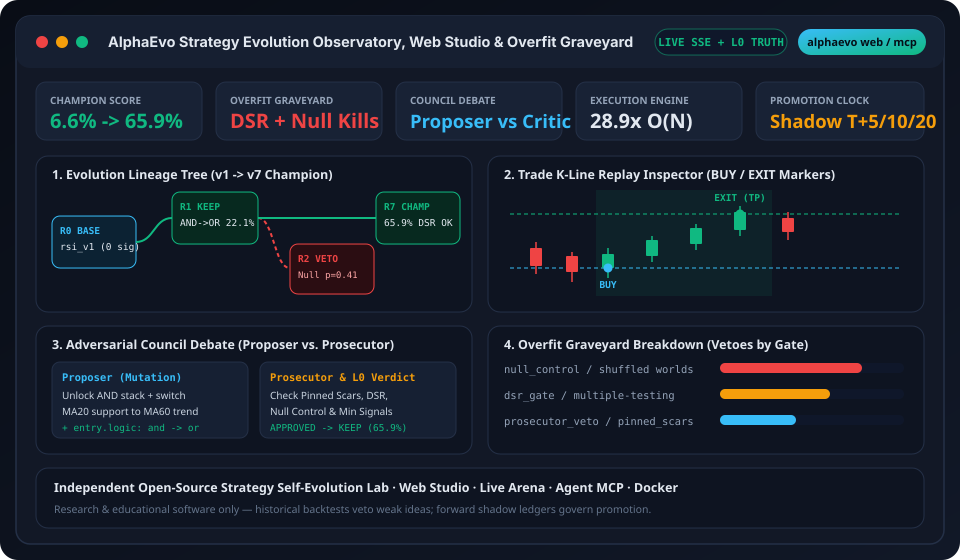

<div align="center">


# 🧬 AlphaEvo

**开源股票策略自进化研究工作台、Live Arena 竞技场与防幻觉 RSI 引擎**

*一句话策略想法 → 可读 YAML DSL → 递归自我进化 → 零信号/DSR 防伪 → 单文件交互 HTML 战报与双时态前瞻影子验真*

[](https://github.com/ZhuLinsen/alphaevo/stargazers)
[](https://github.com/ZhuLinsen/alphaevo/actions/workflows/ci.yml)
[](https://www.python.org/downloads/)
[](../LICENSE)
[](https://zhulinsen.github.io/alphaevo/)
[](../SKILL.md)
[](../Dockerfile)
[](../CONTRIBUTING.md)

[**Studio 与竞技场**](#-研究工作台与-live-arena) · [**竞品对比**](#-为什么是-alphaevo竞品对比) · [**4 种零门槛用法**](#-4-种零门槛上手方式) · [**MCP 与 Agent**](#-3-一行接入-claude-code--openclaw--cursor--codex原生-mcp--skillmd) · [**CLI 命令**](#-cli-命令一览)

[English](../README.md) | [中文](README_CN.md)

</div>

---

## ✨ 项目概览

大多数 AI 股票开源项目停留在 **一次性聊天荐股**、**黑盒代码生成** 或 **只在历史回测里自嗨过拟合**。

AlphaEvo 把股票策略变成**可读、可微调、可证伪、可前瞻追踪**的研究资产：

1. **可视、可控的结构化进化**：把自然语言策略想法编译成可执行 YAML DSL（`triggers` / `guards` / `exit.triggers`），每轮只改控制变量，完整保留 YAML Diff 与研究委员会审讯记录。
2. **零绕过 L0 真相核**：统一由 `EvaluationKernel` 串联 **28.9× 向量化 Daily MTM 回测**、只追加 `TrialLedger` 与 **DSR 多重检验惩罚**、跨截面 **洗牌噪声零信号对照**、物理隔离 `LockedHoldoutVault` 及 **因子运行时 PIT 泄露探针**。
3. **快慢双时钟分离**：**历史回测只负责否决**，真正晋升必须经受 **SHA-256 哈希链前瞻影子账本**（`T+5` / `T+10` / `T+20`、聚类有效样本 $N_{\text{eff}}$ 与回撤熔断）的检验。
4. **开箱即用产品入口**：内置零额外依赖本地 **Web 研究工作台**（`alphaevo web`）、单文件可分享交互式 **Live Arena HTML 看板**（`alphaevo arena run`）、**Fork 即用的 GitHub Actions 每日自进化 + 7 渠道推送**，以及原生 **MCP Server**（`alphaevo mcp` + `SKILL.md`）。

<p align="center" id="研究工作台与-live-arena">
  
</p>

## ⚡ 4 种零门槛上手方式

### 1. 本地 Web 研究工作台 & 实时 SSE 进化流（零额外前后端依赖）
```bash
git clone https://github.com/ZhuLinsen/alphaevo.git && cd alphaevo
pip install -e .
alphaevo web
# 或一条 Docker 命令直接启动 Web Studio：
# docker compose up --build
```
浏览器打开 `http://127.0.0.1:8765` 即可：一句话起草策略 YAML、零试验消耗做 **入场条件通过率 X 射线诊断**（`/api/strategies/diagnose`）、开启 **L2 Co-STEER 动态因子合成**并通过 SSE（`/api/rsi/stream`）实时观看 Stock RSI 进化与否决、查看 **Proposer vs. Prosecutor 对抗辩论卡片**、**3×3 MAP-Elites 行为生态位网格**、**进化家谱树 SVG**、**过拟合处决坟场分布** 与 **单笔交易 K 线复盘图**，一键导出 **DPO 偏好训练对**，或运行 **L3 元机制 A/B 校准实验**、前瞻影子账本仿真与因果风险配权。

### 2. 策略进化观测站（Overfit Graveyard）& 单文件交互 HTML 战报（30 秒无需 Key）
```bash
alphaevo showcase                       # 30 秒真实快照进化闭环（生成 report.md 与带 K 线复盘的 report.html）
alphaevo arena run --rounds 2           # 策略进化观测站 -> reports/arena/index.html + digest.md
```

### 3. 一行接入 Claude Code / OpenClaw / Cursor / Codex（原生 MCP + `SKILL.md`）
```json
{
  "mcpServers": {
    "alphaevo": { "command": "alphaevo", "args": ["mcp"] }
  }
}
```
开箱提供 12 个标准化研究工具（`alphaevo_draft_strategy`、`alphaevo_diagnose_bottlenecks`、`alphaevo_evaluate_strategy`、`alphaevo_evolve_rsi`、`alphaevo_mechanism_ab`、`alphaevo_benchmark_strategies`、`alphaevo_null_audit`、`alphaevo_shadow_simulate`、`alphaevo_audit_factors`、`alphaevo_allocate_portfolio` 等）及宪章/策略库 Resource。详情见 [SKILL.md](../SKILL.md)。

### 4. 在线 GitHub Pages 进化观测站 + Fork 即用定时推送（零服务器成本）
- **在线公共观测站**: [`https://zhulinsen.github.io/alphaevo/`](https://zhulinsen.github.io/alphaevo/)
1. Fork 本仓库并启用 Actions；在仓库 `Settings -> Pages` 中选择 **GitHub Actions** 即可发布交互式进化观测站。
2. 按需在仓库 Secrets 中填入推送渠道：`ALPHAEVO_FEISHU_WEBHOOK`（飞书）、`ALPHAEVO_WECOM_WEBHOOK`（企微）、`ALPHAEVO_DINGTALK_WEBHOOK`（钉钉）、`ALPHAEVO_TELEGRAM_BOT_TOKEN` + `ALPHAEVO_TELEGRAM_CHAT_ID`、`ALPHAEVO_DISCORD_WEBHOOK`、`ALPHAEVO_SLACK_WEBHOOK` 或通用 `ALPHAEVO_WEBHOOK_URL`。
3. [arena-daily.yml](../.github/workflows/arena-daily.yml) 每个工作日自动运行多策略自我进化与过拟合处决审计、发布交互式观测站网页，并向你的群聊推送结果摘要。

## 🧭 为什么是 AlphaEvo：竞品对比

| 维度 | 传统回测库 (`Backtrader` / `VectorBT`) | 多智能体分析 (`TradingAgents` / `ai-hedge-fund`) | 代码自动研发 (`RD-Agent` / `autoresearch`) | **AlphaEvo** |
|------|----------------------------------------|---------------------------------------------------|--------------------------------------------|--------------|
| **进化对象** | 手写 Python 脚本 | 一次性聊天/角色投票 | 任意 Python 代码改写 | **人类可读 YAML DSL + AST/PIT 校验因子** |
| **防多重检验与自嗨** | 需手写 | 默认无系统性防过拟合门槛 | 单一 Holdout 指标 | **`EvaluationKernel` + `TrialLedger` DSR + 洗牌零信号审讯 + 锁定 Holdout** |
| **前瞻真实性** | 手工维护实盘脚本 | 情景重放 / 离线分析 | 离线时间切分 | **SHA-256 双时态前瞻影子账本（`T+5/10/20`、$N_{\text{eff}}$ 与自动熔断）** |
| **产品形态与 Agent 生态** | 仅 Python 库 | 命令行 / 各自脚本 | 较重工程环境 | **内置零依赖 `alphaevo web`、单文件交互 HTML 战报、`alphaevo mcp` + `SKILL.md`** |
| **组合与因子治理** | 需外部拼装 | 基础仓位建议 | 手工筛因子 | **严格因果 `RegimeAdaptiveAllocator` + OOS/PIT `FactorGovernanceEngine`** |

---

### 真实数据对照基准

针对股票投研低信噪比、多重检验过拟合与隐式未来函数等痛点，AlphaEvo 将 **快时钟离线进化探索** 与 **慢时钟前瞻验证** 分离：**历史回测只负责否决，前瞻样本外影子账本才决定晋升**。每次探索都受不可变 L0 真相核（`TrialLedger` + Deflated Sharpe Ratio、零信号对照、运行时 Point-in-Time 泄露探针）和双时态前瞻影子账本约束。

### 可复现无 API Showcase

内置 frozen yfinance 快照，美股科技股篮子，2025-02-11 到 2026-04-10（采用时序等权 **Daily MTM 组合净值口径**、跳空开盘止损/止盈撮合及 **实测参数敏感度**）：

| 策略 | 信号数 | 胜率 | 平均收益 | 最大回撤 | 评分 |
|------|--------|------|----------|----------|------|
| `rsi_reversion_v1` baseline | 0 | 0.0% | 0.00% | 0.0% | 6.6% |
| `rsi_reversion_v7` champion | 37 | 48.6% | 2.94% | 26.7% | 65.9% |

过程：研究委员会先判断入场条件过度确认，解锁信号后以风险调整期望/夏普桥接放宽止损，随后延长持仓、提高止盈倍数、把支撑锚点切到 MA60 并收紧放量确认，每次修改均经过重测。该 champion 在快照上的 train-val / val-test gap 为 7.1% / 7.1%。完整报告见：[showcase_rsi_reversion_real_snapshot.md](reports/showcase_rsi_reversion_real_snapshot.md)。

### 实时数据 LLM 进化路径

实时 yfinance 数据，配置外部 LLM provider 后运行 `alphaevo evolve rsi_reversion_v1 --method llm`，时间为 2026-04-10：

| 策略 | 信号数 | 胜率 | 平均收益 | 评分 |
|------|--------|------|----------|------|
| `rsi_reversion_v1` baseline | 0 | 0.0% | 0.00% | 8.1% |
| `rsi_reversion_v3` LLM champion | 498 | 52.6% | 1.22% | 56.3% |

不同数据窗口和协议不应该直接混排；快照 showcase 是稳定的无 API 首跑，LLM 路径展示的是实时市场数据上的研究闭环。

## 🧠 核心能力与成熟度边界

- **向量化回测与高仿真撮合**：O(N) 预计算指标 (`IndicatorRegistry.precompute`)、O(N) 因果市场状态识别、基准日期对齐、跳空开盘止损/止盈撮合、冻结入场 ATR、`next_open` 实际买点柱 A 股涨跌停/ST/科创创业北交所检测，以及双层评估体系（`daily_mtm` 主口径 + `trade_sequence_*` 诊断对照）。
- **股票策略递归自我进化（`alphaevo rsi`）**：基于 `program.md` 研究宪章驱动策略层（L1）、Co-STEER 因子层（L2）和评估机制（L3）演化，配合 MAP-Elites 档案库、持久化可执行反思伤疤与异构提案/审讯评审（CLI + LiteLLM），导出可核验的 `results.tsv` 账本。
- **L0 真相核与前瞻影子账本（`truth` / `shadow`）**：只追加 `TrialLedger` + DSR（拒绝静默退回内存）、同步跨截面 block-shuffled 与全策略重跑零信号对照、受限命名空间与运行时 PIT 截断保护，以及不可回填倒签的 SHA-256 哈希链前瞻账本（含 `is_replay` 隔离、分阶段滞留门槛与 `HALTED` 保护）。
- **可追踪的研究工作流**：自动沉淀研究委员会裁决、进化树与 SFT/DPO 轨迹数据。

| 模块 / 能力 | 状态 | 说明 |
|-------------|------|------|
| YAML DSL v0.5、O(N) 回测引擎与 Daily MTM 评估 | **已实现 (Implemented)** | Wheel 包内置策略/快照资产；跨平台文件锁；CLI 延迟导入 (~0.1s) |
| 统一 `EvaluationKernel` 与锁定 Holdout (`LockedHoldoutVault`) | **已实现 (Implemented)** | 时间隔离不可见 Holdout、Layer-2 组合硬否决、优化器全量接入 `TrialLedger` 及 CI 全指标 PIT 不变性校验 |
| L0 真相核 (`TrialLedger` / DSR / 零信号对照 / PIT 探针) | **已实现 (Implemented)** | 严格持久化落盘、自定义因子运行时 PIT 截断与 CI Tier-2 零假晋升审讯 |
| 双时钟 RSI 棘轮与前瞻影子账本 (`alphaevo rsi` / `shadow`) | **已实现 (Implemented)** | Co-STEER L2 因子落库 `FactorStore`、统一 `ExperienceStore` 评分口径、SHA-256 哈希链与可选自动入账 |
| 不可变 Run Provenance 与分级排行榜 (`runs` / `leaderboard`) | **已实现 (Implemented)** | `RunArtifactStore` 清单、脱敏配置快照、`DataBundleStore` SHA-256 数据包、`runs rerun-official` 与 `leaderboard --scope local\|official` |
| 多策略市场状态自适应资金配权 (`portfolio allocate`) | **已实现 (Implemented)** | 严格因果波动率倒数、市场状态降权、日频相关性惩罚与回撤去杠杆风险预算 |
| 动态因子全生命周期治理 (`factor audit/prune`) | **已实现 (Implemented)** | 样本外 IC/IR 衰变检验、PIT 重探针、高相关冗余识别与自动退役（含策略引用血缘） |
| 异构多模型议会 (CLI / LiteLLM 审讯) | **已实现 (Implemented)** | 无 Key 时退化为策略无关通用启发式探索 |
| L2/L3 事件新闻与板块情绪指标 | **实验性 (Experimental)** | 缺少外部馈送时自动降级并记录静态上下文警示 (`static_context_warnings`) |
| Web 研究工作台与 Live Arena (`web` / `arena`) | **已实现 (Implemented)** | 零依赖本地 Web Studio、单文件可分享 HTML 竞技场/运行报告及 7 渠道定时推送 |
| AI Agent 原生接入 (`alphaevo mcp` / `SKILL.md`) | **已实现 (Implemented)** | 标准 STDIO JSON-RPC 2.0 MCP 服务，无缝接入 Claude Code / OpenClaw / Cursor / Codex |

## 🚀 快速开始

### 从源码开始，30 秒体验（无需 API Key！）

```bash
git clone https://github.com/ZhuLinsen/alphaevo.git
cd alphaevo
pip install -e .
alphaevo showcase
```

<p align="center">
  
</p>

观看真实历史数据上的策略自我进化：

```
Showcase Chain: baseline + up to 6 validated mutations

Round 1 │ rsi_reversion_v1 │ 信号: 0  │ 评分: 6.6%
  研究委员会：入场条件过严
  修改：entry.logic and -> or

Round 2 │ rsi_reversion_v2 │ 信号: 79 │ 评分: 22.1%
  修改：exit.stop_loss.value 0.05 -> 0.08

Round 7 │ rsi_reversion_v7 │ 信号: 37 │ 评分: 65.9% 🏆
```

### 选择合适的入口

| 目标 | 命令 | 数据 | 是否需要 LLM |
|------|------|------|---------------|
| 真实数据 Showcase（30 秒首跑） | `alphaevo showcase` | 内置 yfinance 快照 | 否 |
| 合成数据开发烟测 | `alphaevo demo --synthetic` | 合成数据 | 否 |
| 一句话策略起草、回测并优化 | `alphaevo strategy research "<idea>"` | 真实数据 | 否 |
| 完整真实数据回测 | `alphaevo run ma_crossover_v1` | yfinance | 否 |
| 测试突破/波动收缩模板 | `alphaevo run volatility_compression_breakout_v1` | yfinance | 否 |
| 联合优化买卖点与防过拟合门控 | `alphaevo optimize <id> --objective robust_profit_quality --reject-overfit` | 真实数据 | 否 |
| 旗舰 LLM 研究智能体进化 | `alphaevo evolve <id> --method llm --output reports/` | 真实数据 | 是 |
| 按研究宪章运行 Stock RSI 进化闭环 | `alphaevo rsi run rsi_reversion_v1 --program examples/rsi_stock_program.md` | 快照或 `--live` | 可选 |
| 洗牌噪声零假晋升审讯 | `alphaevo rsi null-audit rsi_reversion_v1` | 快照或 `--live` | 否 |
| 前瞻双时态影子账本跟踪 | `alphaevo shadow register <id> && alphaevo shadow status` | 快照或实时 | 否 |

真实数据命令需要安装对应数据源扩展：美股 `pip install -e ".[data-yfinance]"`，A 股 `pip install -e ".[data-akshare]"`，全量 `pip install -e ".[data-full]"`。`alphaevo showcase --live` 会优先尝试实时 yfinance，失败时自动回退到本地快照；`optimize` 的完整稳健门槛参数请运行 `alphaevo optimize --help`。

### 当前上线范围

- **最成熟的路径**：`rsi_reversion_v1` 和 `ma_crossover_v1` 用真实数据跑进化
- **最稳的策略类型**：trend + reversal，核心信号来自 OHLCV 和 benchmark
- **偏收益弹性的趋势模板**：`volatility_compression_breakout_v1` 使用前高突破触发、区间位置过滤、波动收缩过滤和 trailing 止盈
- **实验性的**：event + rotation 策略依赖 proxy 做新闻/板块语义，当研究预览看就好

### 完整安装（含 LLM 进化功能）

```bash
# 在仓库根目录补齐 LLM + 默认真实数据能力
pip install -e ".[llm,data-yfinance]"

# 设置 LLM API Key
export ALPHAEVO_API_KEY=your_api_key
export ALPHAEVO_LLM_MODEL=gemini/gemini-3.8-flash  # 或 openai/gpt-6.1-sol、anthropic/claude-sonnet-5.5、deepseek/deepseek-v4-flash

# 跑旗舰 LLM 研究路径
alphaevo evolve rsi_reversion_v1 --method llm --rounds 3 --output reports/rsi_evolve/

# 或按 program.md 宪章运行 L0 真相核约束下的 Stock RSI 闭环
alphaevo rsi run rsi_reversion_v1 --program examples/rsi_stock_program.md --output reports/rsi/
```

如果要跑内置 A 股策略，安装 `pip install -e ".[llm,data-full]"` 后运行 `alphaevo run trend_pullback_rebound_v1 --adapter akshare`。

## 🏗️ 系统架构

```
┌─────────────────────────────────────────────────────────┐
│                    CLI (Typer + Rich)                     │
└────────────────────────┬────────────────────────────────┘
                         │
┌────────────────────────▼────────────────────────────────┐
│            编排层 Orchestrator & Stock RSI 闭环           │
│   宪章 → 采样 → 回测 → 评估 (L0 真相核)                  │
│        → 反思 / Co-STEER → 进化 → 前瞻影子账本           │
└──┬────────┬────────┬────────┬────────┬────────┬─────────┘
   │        │        │        │        │        │
┌──▼──┐ ┌──▼──┐ ┌───▼──┐ ┌──▼──┐ ┌───▼──┐ ┌──▼────────┐
│数据 │ │策略 │ │采样  │ │回测 │ │真相/ │ │反思与      │
│层   │ │层   │ │层    │ │引擎 │ │评估  │ │RSI 进化   │
└─────┘ └─────┘ └──────┘ └─────┘ └──────┘ └───────────┘
```

### 六层架构与进化治理

| 层级 | 职责 |
|------|------|
| **数据层 (`data`)** | 多数据源接入（`yfinance`、`akshare` 或 `daily_stock_analysis` 插件） |
| **策略层 (`strategy`)** | 双重表示：人类可读描述 + 可执行 YAML DSL（含 `SetupSpec`、`PortfolioProfile`） |
| **采样层 (`sampler`)** | 按市场环境、风格、策略适用范围分层采样 |
| **回测引擎 (`backtest`)** | 信号级模拟，支持滑点、手续费与 Point-in-Time 截断 |
| **评估与 L0 真相核 (`evaluator` / `truth`)** | 多维指标 + 只追加 `TrialLedger`、DSR 多重检验修正、零信号对照与运行时 PIT 泄露探针 |
| **反思与 RSI 引擎 (`reflection` / `rsi`)** | 失败归因、Co-STEER L1/L2 分流、MAP-Elites 多样性档案库、异构提案/审讯评审与 `results.tsv` |
| **前瞻影子账本 (`forward`)** | 双时态（`as_of` vs `available_at`）SHA-256 哈希链预测承诺、聚类有效样本 $N_{\text{eff}}$ 与慢升快停晋升门控 |

架构详情见 [Dual-Clock Stock RSI Architecture](rsi_stock_architecture.md) 与宪章示例 [examples/rsi_stock_program.md](../examples/rsi_stock_program.md)。

## 🧬 进化流程示例

拿 **2026年4月10日** yfinance 实盘数据 + `--method llm` 的真实结果举例：

```
第 1 轮: rsi_reversion_v1
         0 个信号，置信度 8.1% — 策略基本废了

         LLM 看完回测结果说："入场条件互相冲突，太严。"
         改了: entry.logic and→or，RSI 30→35

第 2 轮: rsi_reversion_v2 — 能出信号了
         522 个信号，胜率 52.7%，平均 +0.96%
         置信度 39.2%

         LLM 又说："OR 逻辑虽然修好了，但噪声信号太多。"
         改了: RSI 35→32，量比 1.3→1.15，止损 pct→atr

第 3 轮: rsi_reversion_v3 — 最终冠军
         498 个信号，胜率 52.6%，平均 +1.22%
         置信度 56.3%（从 8.1% 到这，涨了 48 个百分点）
```

> 以上是真实运行结果，不是合成数据，不是启发式 fallback。完整报告建议在本地用 `alphaevo evolve <strategy_id> --output ...` 生成。

## 📋 策略 DSL 示例

AlphaEvo 使用 YAML DSL 定义策略，兼具可读性和可执行性：

```yaml
meta:
  id: trend_pullback_rebound_v3
  name: 强趋势回踩放量反包
  version: 3
  parent_id: trend_pullback_rebound_v2
  market: a_share
  category: trend
  tags: [趋势, 回踩, 放量]

description: |
  适用于趋势市。个股近20日相对强于行业指数，
  5日线在10日线上方，回踩10日线附近但未破20日线，
  当日放量1.5倍以上。

entry:
  logic: and
  triggers:
    - indicator: relative_strength_20d
      op: ">"
      value: 0.12
  guards:
    - indicator: ma5_above_ma10
      op: "=="
      value: true
    - indicator: volume_ratio_1d_5d
      op: ">"
      value: 1.5

exit:
  triggers:
    - indicator: close_below_ma10
      op: "=="
      value: true
  stop_loss:
    type: atr
    atr_period: 21
    multiplier: 2.0
  take_profit:
    type: rr
    value: 2.0
  max_holding_days: 10

params:
  tunable:
    - target: entry.triggers[indicator=relative_strength_20d].value
      range: [0.05, 0.20]
      step: 0.01
```

完整的 DSL 规范请参考 [AGENTS.md](../AGENTS.md)。

## 📊 CLI 命令一览

```bash
# 体验与工作台
alphaevo web                              # 启动零依赖本地 Web 研究工作台 (http://127.0.0.1:8765)
alphaevo arena run --rounds 2             # 运行多策略 Live Arena 并导出单文件交互 HTML（支持 --notify）
alphaevo arena notify-test                # 校验飞书/企微/钉钉/Telegram/Discord/Slack 推送配置
alphaevo mcp                              # 启动面向 AI Agent 的 STDIO MCP 服务
alphaevo showcase                         # 内置真实快照 30 秒完整进化演示（生成 report.md + report.html）
alphaevo demo --real                      # 无需 LLM 的真实数据 demo
alphaevo init                             # 交互式初始化配置

# 策略管理
alphaevo strategy draft "<idea>"          # 一句话策略生成可执行 YAML（无需 LLM）
alphaevo strategy research "<idea>"       # 一句话策略→保存→回测→优化（无需 LLM）
alphaevo strategy improve <id> "<改法>"   # 修订已有策略→保存→复测（无需 LLM）
alphaevo strategy list / show <id>        # 查看策略列表与详情

# 回测、优化、数据包、Provenance 与经典进化
alphaevo data bundle create --name us_snap
                                          # 创建 SHA-256 校验的不可变 OHLCV 数据包
alphaevo run <strategy_id> --bundle <bundle_id> --protocol full_research_v1
                                          # 基于不可变数据包跑完整研究闭环并落盘 provenance 工件
alphaevo runs list / show / compare       # 检索与对比不可变 run artifact 清单及策略差异
alphaevo runs html <run_id>               # 将任意不可变运行产物导出为单文件交互 HTML 战报
alphaevo runs rerun-official <id> --bundle <bundle_id>
                                          # 在官方验证数据包上按 official_v1 协议复评
alphaevo portfolio allocate <s1> <s2>     # 多策略因果市场状态自适应风险预算分配
alphaevo optimize <strategy_id> --objective robust_profit_quality --reject-overfit
                                          # 参数与风控搜索（试错接入 TrialLedger，完整选项见 --help）
alphaevo evolve <strategy_id> --method llm --rounds 3 --output reports/
                                          # LLM 引导多轮进化

# 股票递归进化（RSI）、L0 真相核与前瞻影子账本
alphaevo rsi run <id> --holdout-pct 0.20 --portfolio-gate --enroll-shadow
                                          # 按研究宪章运行 L1/L2 Stock RSI 闭环并可选隔离 Holdout 与入账
alphaevo rsi benchmark --rounds 2 --holdout-pct 0.20
                                          # Baseline vs L1 vs L1+L2+语义交叉 可复现消融基准
alphaevo rsi null-audit <id>              # 洗牌噪声零假晋升审讯
alphaevo rsi mechanism-ab <id> --cutoffs 0.55,0.70  # L3 多切分点机理核配对 AB 评测
alphaevo shadow simulate <id>             # 滚动双时态前瞻影子承诺与晋升/熔断仿真
alphaevo shadow register/emit/verify/status  # 前瞻影子账本注册、承诺、兑现与晋升门控
alphaevo truth trials / pit-probe <file>  # 查看 TrialLedger 记录与因子 PIT 泄露探针

# 排行、因子与进化树
alphaevo leaderboard --scope local        # 策略排行榜（--scope official 严格仅展示 official_v1 通过项）
alphaevo tree <strategy_id>               # 查看策略进化树
alphaevo factor discover <symbol>         # LLM 驱动因子发现
alphaevo factor audit                     # 动态因子 OOS 衰变 / 冗余 / PIT / 引用血缘审计
alphaevo factor prune --dry-run           # 预览或退役衰退、冗余与 PIT 违规因子
```

完整命令列表请运行 `alphaevo --help`。

## 📚 参考

- **FunSearch (Nature 2024)** — Island 并行搜索与分支竞争
- **OPRO (DeepMind 2023)** — 以轨迹历史驱动 LLM 优化
- **Voyager (2023)** — 技能库 + 长期记忆
- **autoresearch (Karpathy)** — 基于 `program.md` 宪章的自主假设搜索与 `results.tsv` 棘轮机制
- **RD-Agent / Co-STEER** — 策略与因子协同进化及经验疤痕复用

AlphaEvo 把这些思路落到了可证伪的股票量化策略研究场景。

## 🔬 真实验证结果（2026 年 4 月 10 日）

故意同时放成功和失败的案例——靠谱的研究系统应该在证据不够时老实停下来：

| 策略案例 | 起点 | 最优结果 | 发生了什么 |
|----------|------|----------|------------|
| `rsi_reversion_v1` | `8.1%` | `56.3%` champion | 3 轮内从零信号修成可交易策略（498 信号，胜率 52.6%） |
| `ma_crossover_v1` | `24.2%` | `24.2%` champion | LLM 提出修改，但未通过防过拟合检验，保留基线 |
| `sector_rotation_leader_v1` smoke | `11.3%` | `12.3%` tested | 样本内提升但 `train_val_gap=18.9%`，拒绝晋升 |

- **因子发现**：`alphaevo factor discover AAPL` 提出 3 个候选，2 个通过沙箱与 IC 验证并注册（`volatility_compressed_breakout_quality` IC Mean `0.306` / IR `1.76`；`volume_confirmed_reversal` IC Mean `0.248` / IR `1.50`），详见 [Factor Discovery Walkthrough](cookbook/07_factor_discovery_walkthrough.md)。
- **导出产物**：每次运行自动保存研究报告、LLM 证据日志、research log 与 trajectory 数据。

### 可复跑 Benchmark

```bash
python scripts/experiments/run_repro_benchmark.py \
  --adapter yfinance --method llm --rounds 3 \
  --output results/repro-benchmark/
```

详细记录：[2026-04-10 真实 LLM 验证报告](reports/2026-04-10-real-llm-validation_CN.md)。

### 已知边界

- 外部 LLM 服务可能有延迟和 timeout，重复跑结果不会完全一致
- LLM 诊断合理不代表能通过防过拟合或 DSR / 零信号检验（`ma_crossover_v1` 就是例子）
- 自动发现的因子和影子账本记录仅作研究参考，正式使用前需独立复核

## 🧠 Trajectory 数据飞轮

每次进化不光改策略，还自动生成训练数据：

- `trajectory.jsonl`：每轮（状态 → 诊断 → 改动 → 结果）的结构化记录
- `sharegpt.jsonl`：对话格式，可直接拿去做 SFT
- `preference.jsonl`：优劣对比，适合 DPO 训练

详见：[Trajectory Data Flywheel](trajectory_data_flywheel.md)

## 🛡️ 防过拟合

AlphaEvo 内置多重防过拟合与防幻觉机制：

- **时间分离 & Walk-Forward**：训练 / 验证 / 测试严格分离，配合滚动 12 个月训练 → 1 个月测试窗口
- **复杂度与稳定性惩罚**：条件数惩罚、最小信号数门槛（< 30 降权）、跨市场状态一致性及参数 ±10% 扰动敏感度检查
- **多重检验修正（`TrialLedger` + DSR）**：只追加账本统计同一研究家族试错总次数，对历史 Sharpe 施加 Deflated Sharpe Ratio 惩罚
- **零信号对照与运行时 PIT 探针**：对照 `block_shuffle` / `time_shift` / `random_entry` 的 95 分位门槛，并用未来行噪声扰动检测隔离检测隐式未来函数
- **前瞻影子账本晋升门控**：历史回测只能否决，晋升需满足双时态样本外追踪、聚类有效样本数 $N_{\text{eff}}$ 与回撤红线熔断

## 🔌 兼容性

### 独立模式

开箱即用，内置 `yfinance`（美股/港股）和 `akshare`（A 股）数据源。

### 插件模式

可对接 [daily_stock_analysis](https://github.com/ZhuLinsen/daily_stock_analysis)，复用其多数据源自动 fallback 能力。

```python
from alphaevo.data.adapters.yfinance import YFinanceAdapter
data_manager = DataManager([YFinanceAdapter()])

from alphaevo.data.adapters.dsa import DSAAdapter
data_manager = DataManager([DSAAdapter(dsa_path="/path/to/dsa")])
```

## 📦 安装选项

```bash
pip install -e .                  # 核心安装（仅回测与离线 RSI 闭环）
pip install -e ".[llm]"           # 带 LLM 支持（策略生成与进化）
pip install -e ".[data-yfinance]" # 默认美股 / 港股数据源
pip install -e ".[data-akshare]"  # A 股数据源
pip install -e ".[data-full]"     # 全部数据源
pip install -e ".[dev]"           # 开发环境
```

## 🗺️ 路线图

- [x] Phase 1: 策略研究闭环 (MVP) — 回测引擎、指标、评估器
- [x] Phase 2: 自我进化流水线 — LLM 反思、变异、多轮改进
- [x] Phase 3: CLI & 编排 — 完整命令行、策略存储、排行榜
- [x] Phase 4: 开源打磨 — CI/CD、文档、英文模板、CHANGELOG
- [x] Phase 5: 真实验证 — 实盘数据回测 + 真实 LLM 进化验证
- [x] Phase 6: 股票递归自我进化（RSI）与前瞻影子账本 — `TrialLedger` + DSR、零信号对照、PIT 探针、MAP-Elites、异构评审与双时态承诺追踪
- [x] Phase 7: 市场环境自适应多策略风控配权与不可变数据包 — `RegimeAdaptiveAllocator`、`DataBundleStore`、`runs rerun-official` 与 `EvolutionPipeline` 统一收敛
- [x] Phase 8: 进化观测站、交互 Web Studio 与 Agent 生态 — 零依赖 `alphaevo web` + SSE 实时流 (`/api/rsi/stream`)、对抗辩论卡片、进化家谱树与 K 线买卖点复盘 SVG、过拟合坟场 `alphaevo arena`、`alphaevo mcp` + `SKILL.md`、7 渠道推送及 Docker / GitHub Pages 自动部署

## 🤝 参与贡献

欢迎贡献！请查看 [CONTRIBUTING.md](../CONTRIBUTING.md) 了解详细指南。

**特别欢迎以下贡献：**
- 新的策略模板
- 数据源适配器
- 评估指标与机制实验
- UI / 可视化改进

## ☕ 支持与联系

觉得有用的话给个 ⭐ 吧！

<table>
  <tr>
    <td align="center" width="220">
      <a href="https://www.xiaohongshu.com/user/profile/61594417000000000201fa68" target="_blank">
        <br>
        <b>小红书 📱</b>
      </a><br>
      <sub>关注获取量化策略研究动态</sub>
    </td>
    <td valign="top" style="padding-left: 24px">
      <b>📬 联系与合作</b><br><br>
      🐛 &nbsp;<a href="https://github.com/ZhuLinsen/alphaevo/issues">提交 Issue</a> — Bug 反馈 / 功能建议<br>
      📧 &nbsp;<a href="mailto:zhuls345@gmail.com">zhuls345@gmail.com</a> — 商务合作<br>
      🔗 &nbsp;<a href="https://github.com/ZhuLinsen/daily_stock_analysis">daily_stock_analysis</a> — 关联项目，AI 驱动的每日股票智能分析系统
    </td>
  </tr>
</table>

## ⚠️ 免责声明

**本项目仅供研究和学习，不是投资建议。**

作者不对使用本软件导致的任何经济损失负责。投资决策前请自行研究并咨询专业人士。

回测结果与影子账本记录仅作研究模拟，不代表未来表现。

## 📄 许可证

Apache-2.0 License — 详见 [LICENSE](../LICENSE)。

如果你在项目中用到或基于它做二次开发，欢迎注明来源。

---

<div align="center">


</div>
